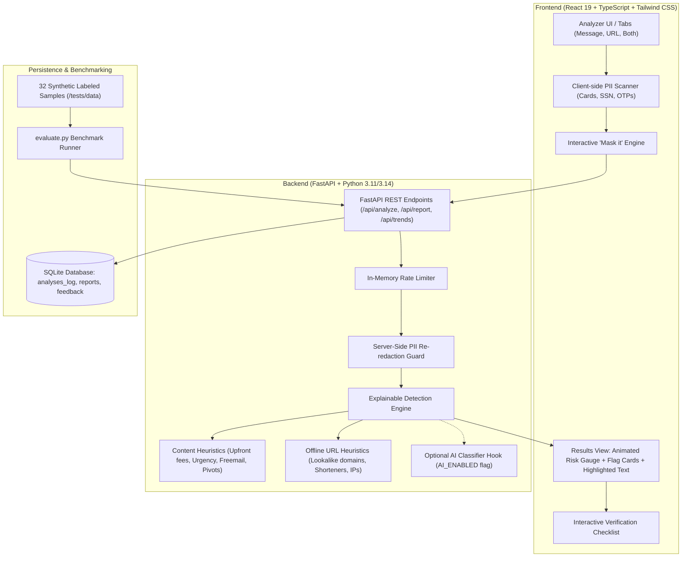

# HireShield 

> **LaserHack 2026** (Cybersecurity + AI Track)  
> Explainable Recruitment Fraud Early Warning & Education System

HireShield helps students and early-career job seekers spot recruitment fraud before they lose money or sensitive credentials. The applicant pastes a job description, recruiter message (e.g. WhatsApp, LinkedIn, Telegram), or URL. The app returns an explainable risk assessment: a calculated risk level, exact quoted red flags with educational explanations, what evidence is unknown, and an actionable 5-step verification checklist.

**HireShield is an early-warning and education tool, never a verdict.** It never claims an offer is definitely fake or genuine, and never accuses named entities.

---

##  Architecture



---

##  Quick Start (Single Command)

### Prerequisites
- **Node.js**: v18+ (tested on Node v24)
- **Python**: 3.11+ (tested on Python 3.14)
- **npm**: 9+

### 1. Install Dependencies
```bash
# Install root orchestrator dependencies
npm install

# Install frontend dependencies
cd frontend && npm install && cd ..

# Install backend dependencies
python -m pip install -r backend/requirements.txt
```

### 2. Start Both Frontend & Backend with One Command
```bash
npm run dev
```

- **Frontend**: [http://localhost:5173](http://localhost:5173)
- **Backend API Docs**: [http://127.0.0.1:8000/docs](http://127.0.0.1:8000/docs)
- **Health Check**: [http://127.0.0.1:8000/api/health](http://127.0.0.1:8000/api/health)

---

##  GitHub & Deployment

GitHub stores the source code and runs the checks in `.github/workflows/ci.yml`; GitHub Pages cannot host the FastAPI backend or its database. The included `Dockerfile` builds the React frontend and serves it from the FastAPI app, so deploy the container to a host that supports Docker.

### Push this project to GitHub

1. Create an empty repository on GitHub (do not initialize it with a README or `.gitignore`).
2. From this project folder, run:

   ```bash
   git init
   git add .
   git commit -m "Prepare HireShield for deployment"
   git branch -M main
   git remote add origin https://github.com/YOUR_USERNAME/YOUR_REPOSITORY.git
   git push -u origin main
   ```

   Replace the remote URL with your repository URL. The root `.gitignore` excludes dependencies, build output, local databases, Python caches, and environment secrets.
3. GitHub Actions runs backend tests and frontend lint, tests, and build on pushes and pull requests to `main`.
4. `.github/workflows/deploy.yml` builds and publishes a Docker image to GitHub Container Registry (GHCR) on pushes to `main`, version tags (`v*`), or a manual workflow run. The image is named `ghcr.io/YOUR_USERNAME/YOUR_REPOSITORY`; the workflow uses GitHub's `GITHUB_TOKEN`, so no registry password needs to be added.

### Run the published app container

GitHub Actions publishes the image but does not host or run the app. In a Docker hosting provider, create a web service using the published GHCR image and configure:

- **Build context:** repository root
- **Dockerfile:** `Dockerfile`
- **Port:** use the port supplied by the hosting platform (the container reads `PORT`, defaulting to `8000`)
- **Health check:** `/api/health`
- **Persistent storage:** mount a durable volume and set `DATABASE_URL` to a SQLite file on that volume, for example `sqlite:////var/data/hireshield.db`

The default SQLite database lives inside the app directory and is suitable for local development, but container filesystems may be temporary. Configure persistent storage before accepting user accounts or reports, otherwise data can be lost when the host replaces the container. Do not commit `.env` files or production credentials; set secrets through your host's environment settings.

If the GHCR package is private, configure your hosting provider with a GitHub token that can read packages, or make the package public in the GitHub package settings.

To build and run the same container locally:

```bash
docker build -t hireshield .
docker run --rm -p 8000:8000 hireshield
```

Open [http://localhost:8000](http://localhost:8000) for the app and [http://localhost:8000/docs](http://localhost:8000/docs) for API documentation.

---

##  Testing & Benchmark Evaluation

### Run All Tests (Backend + Frontend)
```bash
npm test
```
- **Backend**: 22 unit & integration tests covering every content rule, URL rule, redaction, and API endpoints.
- **Frontend**: 4 Vitest / React Testing Library tests covering client masking and analyzer UI workflows.

### Run Benchmark Script
```bash
npm run eval
# or: cd backend && python evaluate.py
```

###  Measured Accuracy (Computed directly from `backend/tests/data/evaluation_dataset.json`)
| Metric | Value | Description |
|---|---|---|
| **Planted Scam Detection** | **100.0%** (20/20) | Scams correctly flagged as HIGH or MEDIUM risk |
| **False-Positive Rate** | **0.0%** (0/12) | Legitimate job listings misclassified as suspicious |
| **Total Test Dataset** | **32 samples** | Balanced synthetic test suite across 10+ attack vectors |
| **Evaluation Timestamp** | `2026-10-10 11:07:04 UTC` | Generated from `python evaluate.py` |

---

##  API Documentation

### `POST /api/analyze`
Analyzes recruiter messages or URLs. Never logs raw text to disk.
- **Request Body**:
  ```json
  {
    "text": "Google hiring! Registration fee of $150 required. Reply within 24 hours to hr@gmail.com",
    "url": null
  }
  ```
- **Response**:
  ```json
  {
    "analysis_id": "97ebaa40-6644-48f5-938b-ca1b61da283d",
    "risk_level": "HIGH",
    "score": 85,
    "summary": "Multiple high-severity red flags detected typical of fee or credential recruitment fraud.",
    "flags": [
      {
        "id": "RULE_FEE_UPFRONT",
        "title": "Upfront Payment or Deposit Required",
        "severity": "HIGH",
        "weight": 40,
        "evidence": "Registration fee of $150",
        "span": [23, 47],
        "why": "Legitimate employers never require candidates to pay fees for applications, equipment, training, or onboarding."
      }
    ],
    "unknowns": [
      "No company or application URL provided to inspect domain legitimacy.",
      "Compensation details and structure were not specified in the message."
    ],
    "checklist": [
      "Find the company's official careers page directly without clicking provided links",
      "Verify the recruiter through official channels",
      "Never pay a fee to secure a job"
    ],
    "content_signals": 3,
    "url_signals": 0,
    "disclaimer": "HireShield is an early-warning and education tool, not a guarantee..."
  }
  ```

### `POST /api/report`
Saves an anonymized scam report with double server-side PII scrubbing.
- **Request Body**:
  ```json
  {
    "scam_type": "fee",
    "platform": "WhatsApp",
    "redacted_text": "Scammer demanded $150 fee. Contact [PHONE_REDACTED]"
  }
  ```

### `POST /api/feedback`
Records candidate feedback on analysis accuracy.
- **Request Body**:
  ```json
  {
    "analysis_id": "uuid",
    "helpful": true,
    "comment": "Identified the fake training deposit immediately."
  }
  ```

### `GET /api/trends`
Returns aggregated anonymized metrics and latest benchmark results.

### `GET /api/health`
Returns system health, version, and optional AI module state.

---

## Design System & Accessibility

- **Theme**: Pure white `#FFFFFF` page background with soft `#F6F8FB` card surfaces and `#E6ECF3` borders.
- **Typography**: Inter (Google Fonts) with tight heading tracking and generous whitespace.
- **Palette**:
  - Headings: Navy `#0B1F3A`
  - Body: Slate `#5B6678`
  - Accent: Teal `#00A896` (hover `#007F73`)
  - Risk High: `#E5484D` (paired with AlertTriangle icon & text label)
  - Risk Medium: `#F5A524` (paired with AlertCircle icon & text label)
  - Risk Low: `#2FB171` (paired with CheckCircle2 icon & text label)
  - Neutral / Unknown: `#8A94A6` (paired with HelpCircle icon & text label)
- **Responsive**: Fully responsive across mobile (375px), tablet (768px), and desktop (1280px).
- **Accessibility**: WCAG AA contrast, visible focus rings, ARIA labels, semantic markup, and never relies on color alone.

---

##  Privacy Stance & Ethical Guardrails

1. **Client-Side Sensitive Data Scanning**: When a user pastes text containing OTPs, card numbers, or government IDs (SSN, Aadhaar), HireShield displays a warning and offers a one-click **Mask it** action before submission.
2. **Double Server-Side Redaction**: The backend strips emails, phone numbers, payment cards, national IDs, and credentials. Raw user text is never saved to database or written to server log files.
3. **Offline URL Inspection**: URLs are parsed as heuristic strings. HireShield makes **zero external HTTP requests** to submitted URLs, preventing attacker tracking pixels or IP logging.
4. **No Verdicts or Direct Accusations**: The tool explicitly lists unknowns, notes missing evidence, and presents an interactive verification checklist.

---

##  Limitations

- **Not an Employment Guarantee**: Sophisticated targeted spear-phishing or newly compromised domains may evade basic pattern filters. A "Low Risk" rating means no red flags were triggered, not an endorsement of authenticity.
- **Static String Parsing**: Without querying live DNS or WHOIS records (intentional for privacy and speed), newly registered domains without obvious typosquatting cues require user vigilance.
- **Human Verification Required**: Candidates must always verify offers through official, authenticated career channels.
