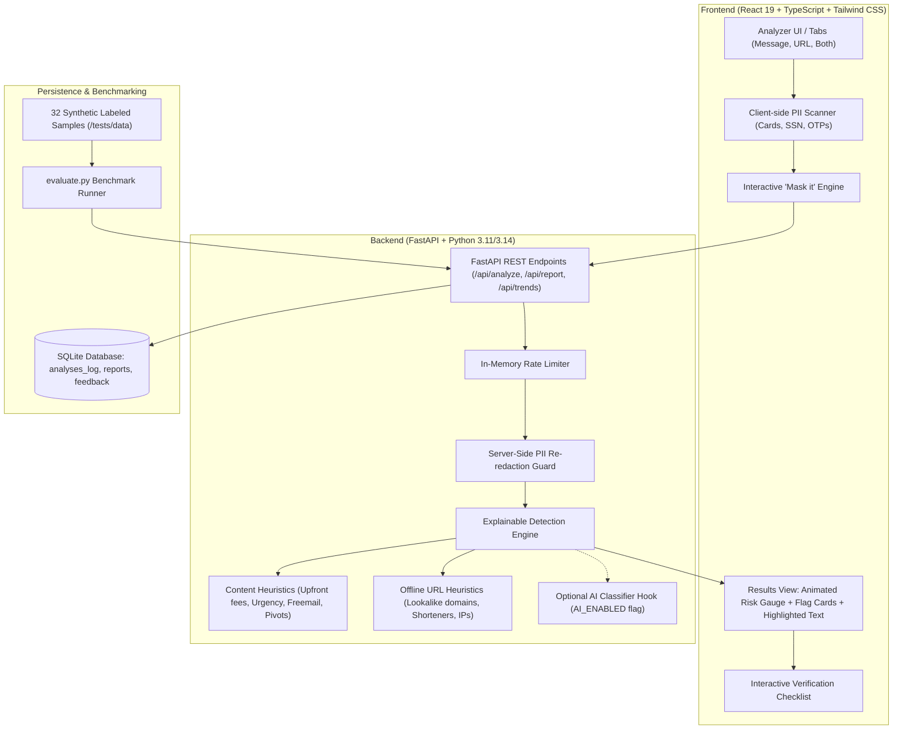

# HireShield 

> **LaserHack 2026** (Cybersecurity + AI Track)  
> Explainable Recruitment Fraud Early Warning & Education System

HireShield helps students and early-career job seekers spot recruitment fraud before they lose money or sensitive credentials. The applicant pastes a job description, recruiter message (e.g. WhatsApp, LinkedIn, Telegram), or URL. The app returns an explainable risk assessment: a calculated risk level, exact quoted red flags with educational explanations, what evidence is unknown, and an actionable 5-step verification checklist.

**HireShield is an early-warning and education tool, never a verdict.** It never claims an offer is definitely fake or genuine, and never accuses named entities.

---

##  Architecture



---

##  Quick Start (Single Command)

### Prerequisites
- **Node.js**: v18+ (tested on Node v24)
- **Python**: 3.11+ (tested on Python 3.14)
- **npm**: 9+

### 1. Install Dependencies
```bash
# Install root orchestrator dependencies
npm install

# Install frontend dependencies
cd frontend && npm install && cd ..

# Install backend dependencies
python -m pip install -r backend/requirements.txt
```

### 2. Start Both Frontend & Backend with One Command
```bash
npm run dev
```

- **Frontend**: [http://localhost:5173](http://localhost:5173)
- **Backend API Docs**: [http://127.0.0.1:8000/docs](http://127.0.0.1:8000/docs)
- **Health Check**: [http://127.0.0.1:8000/api/health](http://127.0.0.1:8000/api/health)

---

## GitHub Pages Deployment

### Push this project to GitHub

1. Create an empty repository on GitHub (do not initialize it with a README or `.gitignore`).
2. From this project folder, run:

   ```bash
   git init
   git add .
   git commit -m "Prepare HireShield for deployment"
   git branch -M main
   git remote add origin https://github.com/YOUR_USERNAME/YOUR_REPOSITORY.git
   git push -u origin main
   ```

   Replace the remote URL with your repository URL. The root `.gitignore` excludes dependencies, build output, local databases, Python caches, and environment secrets.
3. In the repository, open **Settings → Pages** and set the source to **GitHub Actions**.
4. Push to `main`. The **CI** workflow runs the checks. When it succeeds, `.github/workflows/deploy.yml` builds the frontend and publishes it to GitHub Pages automatically. The live URL is shown in the workflow's deployment job and under **Settings → Pages**; it is usually `https://YOUR_USERNAME.github.io/YOUR_REPOSITORY/`.

This workflow publishes a **static frontend only**. GitHub Pages and GitHub Actions do not run the FastAPI backend or SQLite database. Therefore, backend-powered features such as analysis, authentication, reporting, feedback, and trends will not work on this site. Running those features requires hosting the backend and database on a server; this deployment does not configure one.

---

## Full-stack Docker Deployment

The Docker deployment runs the built React frontend and FastAPI backend together in the app container. Caddy sits in front as a reverse proxy and automatically provisions/renews HTTPS certificates. The app and database are not exposed directly to the internet; only ports 80 and 443 are published.

### Requirements

- A Linux VPS or server with a public IP address (Ubuntu 22.04/24.04 recommended)
- A domain name you control, with its DNS `A` record pointing to the server's public IPv4 address
- Docker Engine and the Docker Compose plugin installed on the server
- Inbound TCP ports 80 and 443 allowed by the server/cloud firewall (UDP 443 is optional, for HTTP/3)

If you publish an `AAAA` record, it must point to a working IPv6 address on the server; otherwise remove it. Keep SSH access available when changing firewall rules.

### Deploy on a server

1. Install Docker Engine and the Compose plugin using Docker's official instructions for your Linux distribution. Confirm both are available:

   ```bash
   docker --version
   docker compose version
   ```

2. Point your domain's DNS `A` record to the VPS public IP, and allow ports 80 and 443 in both the VPS firewall and any cloud-provider firewall.

3. Connect to the VPS over SSH and clone this repository:

   ```bash
   git clone https://github.com/YOUR_USERNAME/YOUR_REPOSITORY.git hireshield
   cd hireshield
   ```

4. Create the deployment environment file and edit it:

   ```bash
   cp .env.example .env
   nano .env
   ```

   Set `DOMAIN` to the real domain (for example, `hireshield.example.com`) and `ACME_EMAIL` to an email address for HTTPS certificate notices. Keep `DATABASE_URL=sqlite:////data/hireshield.db` for the supplied persistent SQLite volume. `.env` is git-ignored; do not commit it.

5. Build and start the full stack:

   ```bash
   docker compose up -d --build
   ```

   The first start builds both app layers and may take a few minutes. Caddy will request the HTTPS certificate after DNS resolves to this server and ports 80/443 are reachable.

6. Check service health and logs:

   ```bash
   docker compose ps
   docker compose logs -f app caddy
   ```

   Open `https://YOUR_DOMAIN` in a browser. Verify the backend through the same public HTTPS endpoint:

   ```bash
   curl https://YOUR_DOMAIN/api/health
   ```

### Updating the deployment

From the repository directory on the server:

```bash
git pull
docker compose up -d --build
docker compose ps
```

The database is stored in the named `hireshield-data` Docker volume and survives container rebuilds and `docker compose down`. **Do not use `docker compose down -v` for routine stops or updates**; `-v` deletes the database and Caddy certificate volumes.

To make a consistent SQLite backup while the service is running:

```bash
docker compose exec -T app python -c "import sqlite3; source=sqlite3.connect('/data/hireshield.db'); target=sqlite3.connect('/tmp/hireshield-backup.db'); source.backup(target); target.close(); source.close()"
docker compose cp app:/tmp/hireshield-backup.db ./hireshield-backup.db
```

Store the backup somewhere secure and outside the server. It contains account and application data.

### Local Docker smoke test

To build and run the same container stack on a machine without a public domain, copy `.env.example` to `.env`, set `DOMAIN=:80` and `ACME_EMAIL=admin@example.com`, then run:

```bash
docker compose up -d --build
```

Open `http://localhost` (Caddy will not issue a public TLS certificate for `localhost`). Run `docker compose down` when finished; this stops the services while preserving their named volumes.

---

##  Testing & Benchmark Evaluation

### Run All Tests (Backend + Frontend)
```bash
npm test
```
- **Backend**: 22 unit & integration tests covering every content rule, URL rule, redaction, and API endpoints.
- **Frontend**: 4 Vitest / React Testing Library tests covering client masking and analyzer UI workflows.

### Run Benchmark Script
```bash
npm run eval
# or: cd backend && python evaluate.py
```

###  Measured Accuracy (Computed directly from `backend/tests/data/evaluation_dataset.json`)
| Metric | Value | Description |
|---|---|---|
| **Planted Scam Detection** | **100.0%** (20/20) | Scams correctly flagged as HIGH or MEDIUM risk |
| **False-Positive Rate** | **0.0%** (0/12) | Legitimate job listings misclassified as suspicious |
| **Total Test Dataset** | **32 samples** | Balanced synthetic test suite across 10+ attack vectors |
| **Evaluation Timestamp** | `2026-10-10 11:07:04 UTC` | Generated from `python evaluate.py` |

---

##  API Documentation

### `POST /api/analyze`
Analyzes recruiter messages or URLs. Never logs raw text to disk.
- **Request Body**:
  ```json
  {
    "text": "Google hiring! Registration fee of $150 required. Reply within 24 hours to hr@gmail.com",
    "url": null
  }
  ```
- **Response**:
  ```json
  {
    "analysis_id": "97ebaa40-6644-48f5-938b-ca1b61da283d",
    "risk_level": "HIGH",
    "score": 85,
    "summary": "Multiple high-severity red flags detected typical of fee or credential recruitment fraud.",
    "flags": [
      {
        "id": "RULE_FEE_UPFRONT",
        "title": "Upfront Payment or Deposit Required",
        "severity": "HIGH",
        "weight": 40,
        "evidence": "Registration fee of $150",
        "span": [23, 47],
        "why": "Legitimate employers never require candidates to pay fees for applications, equipment, training, or onboarding."
      }
    ],
    "unknowns": [
      "No company or application URL provided to inspect domain legitimacy.",
      "Compensation details and structure were not specified in the message."
    ],
    "checklist": [
      "Find the company's official careers page directly without clicking provided links",
      "Verify the recruiter through official channels",
      "Never pay a fee to secure a job"
    ],
    "content_signals": 3,
    "url_signals": 0,
    "disclaimer": "HireShield is an early-warning and education tool, not a guarantee..."
  }
  ```

### `POST /api/report`
Saves an anonymized scam report with double server-side PII scrubbing.
- **Request Body**:
  ```json
  {
    "scam_type": "fee",
    "platform": "WhatsApp",
    "redacted_text": "Scammer demanded $150 fee. Contact [PHONE_REDACTED]"
  }
  ```

### `POST /api/feedback`
Records candidate feedback on analysis accuracy.
- **Request Body**:
  ```json
  {
    "analysis_id": "uuid",
    "helpful": true,
    "comment": "Identified the fake training deposit immediately."
  }
  ```

### `GET /api/trends`
Returns aggregated anonymized metrics and latest benchmark results.

### `GET /api/health`
Returns system health, version, and optional AI module state.

---

## Design System & Accessibility

- **Theme**: Pure white `#FFFFFF` page background with soft `#F6F8FB` card surfaces and `#E6ECF3` borders.
- **Typography**: Inter (Google Fonts) with tight heading tracking and generous whitespace.
- **Palette**:
  - Headings: Navy `#0B1F3A`
  - Body: Slate `#5B6678`
  - Accent: Teal `#00A896` (hover `#007F73`)
  - Risk High: `#E5484D` (paired with AlertTriangle icon & text label)
  - Risk Medium: `#F5A524` (paired with AlertCircle icon & text label)
  - Risk Low: `#2FB171` (paired with CheckCircle2 icon & text label)
  - Neutral / Unknown: `#8A94A6` (paired with HelpCircle icon & text label)
- **Responsive**: Fully responsive across mobile (375px), tablet (768px), and desktop (1280px).
- **Accessibility**: WCAG AA contrast, visible focus rings, ARIA labels, semantic markup, and never relies on color alone.

---

##  Privacy Stance & Ethical Guardrails

1. **Client-Side Sensitive Data Scanning**: When a user pastes text containing OTPs, card numbers, or government IDs (SSN, Aadhaar), HireShield displays a warning and offers a one-click **Mask it** action before submission.
2. **Double Server-Side Redaction**: The backend strips emails, phone numbers, payment cards, national IDs, and credentials. Raw user text is never saved to database or written to server log files.
3. **Offline URL Inspection**: URLs are parsed as heuristic strings. HireShield makes **zero external HTTP requests** to submitted URLs, preventing attacker tracking pixels or IP logging.
4. **No Verdicts or Direct Accusations**: The tool explicitly lists unknowns, notes missing evidence, and presents an interactive verification checklist.

---

##  Limitations

- **Not an Employment Guarantee**: Sophisticated targeted spear-phishing or newly compromised domains may evade basic pattern filters. A "Low Risk" rating means no red flags were triggered, not an endorsement of authenticity.
- **Static String Parsing**: Without querying live DNS or WHOIS records (intentional for privacy and speed), newly registered domains without obvious typosquatting cues require user vigilance.
- **Human Verification Required**: Candidates must always verify offers through official, authenticated career channels.
